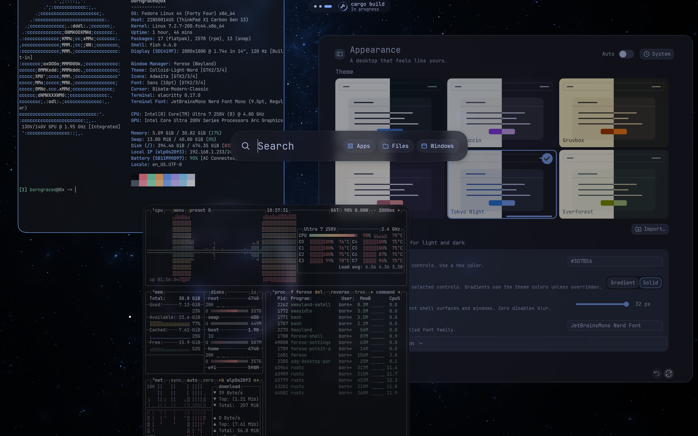

<p align="center">
  
</p>

<p align="center"><strong>A configurable Wayland desktop</strong></p>

<p align="center">
  <a href="https://github.com/ferese-wm/ferese/releases">Download</a> ·
  <a href="https://github.com/ferese-wm/ferese/wiki/Installation">Install</a> ·
  <a href="https://github.com/ferese-wm/ferese/wiki/Configuration">Configure</a> ·
  <a href="https://github.com/ferese-wm/ferese/wiki">Documentation</a>
</p>

Ferese is a Linux desktop built in Rust with Smithay. It includes a window manager,
desktop shell, Settings and a lock screen, with shared configuration and theming.
Choose a layout per workspace and configure the desktop through Settings or a KDL file.

**Beta:** [0.1.0-beta](https://github.com/ferese-wm/ferese/releases/tag/v0.1.0-beta)
has packages for Fedora 44 and Arch Linux on x86_64. This README and the wiki
describe `main`.



[Screenshots](https://github.com/ferese-wm/ferese/wiki/Screenshots)

## Using Ferese

- Use scrolling columns, tree tiling, floating windows and
  [tabbed window groups](https://github.com/ferese-wm/ferese/wiki/Tabbed-Windows).
- Arrange [panel items and groups](https://github.com/ferese-wm/ferese/wiki/Panel-Configuration),
  place the panel at the top or bottom, and choose its style.
- Follow command and build progress in the panel with
  [Live Activities](https://github.com/ferese-wm/ferese/wiki/Live-Activities).
- Set up [binding modes](https://github.com/ferese-wm/ferese/wiki/Configuration-Bindings#binding-modes)
  for resizing, launching apps and other shortcut groups.
- Change themes, wallpapers, blur and animation settings across the desktop.
  Configuration edits apply live. Invalid edits leave the last working configuration active.
- Manage displays, Wi-Fi, Bluetooth and audio from Settings and Control Center.
  Multiple monitors, fractional scaling and monitor mirroring are supported.
- Annotate screenshots, share a window or display, and record a monitor or selected
  region with audio.

The [feature roadmap](https://github.com/ferese-wm/ferese/issues/5) tracks implemented features and remaining work.

## Install

Download the package for your distribution from
[Releases](https://github.com/ferese-wm/ferese/releases/tag/v0.1.0-beta), then follow
the [package installation instructions](https://github.com/ferese-wm/ferese/wiki/Packages-and-Releases#install-a-release-package).
The release notes list the beta's limitations.

To build the current development version, install the
[build dependencies](https://github.com/ferese-wm/ferese/wiki/Installation#requirements)
and run these commands as your normal user:

```sh
git clone https://github.com/ferese-wm/ferese.git
cd ferese
./scripts/install.sh
```

Once installed, log out and select **Ferese** at your login screen, or run
`ferese-session` from a local TTY. You can also try a
[nested preview](https://github.com/ferese-wm/ferese/wiki/Installation#preview-and-logs)
inside your existing Wayland desktop.

## Configure

Open **Control Center → Settings** or edit `~/.config/ferese/config.kdl`.
The [configuration reference](https://github.com/ferese-wm/ferese/wiki/Configuration)
and [example config](packaging/config.kdl) cover appearance, layouts, displays,
window rules and startup apps.

## First shortcuts

`Super` is usually the Windows key. Change shortcuts and gestures in **Settings → Shortcuts**.

| Control | Action |
| --- | --- |
| Super + Enter | Open a terminal |
| Super + H / J / K / L | Focus left / down / up / right |
| Super + Tab | Open overview |
| Super + M | Switch scrolling / tree layout |
| Super + Shift + E | Ask to log out |

See [all shortcuts and gestures](https://github.com/ferese-wm/ferese/wiki/Shortcuts-and-Gestures)
for resizing, grouping windows, screenshots and workspace navigation.

## Development and bug reports

[Development instructions](https://github.com/ferese-wm/ferese/wiki/Development)
cover building, tests and hardware checks. To
[report a bug](https://github.com/ferese-wm/ferese/issues), include steps to reproduce it,
your version or commit, relevant logs, and whether you ran a nested preview or a direct session.
