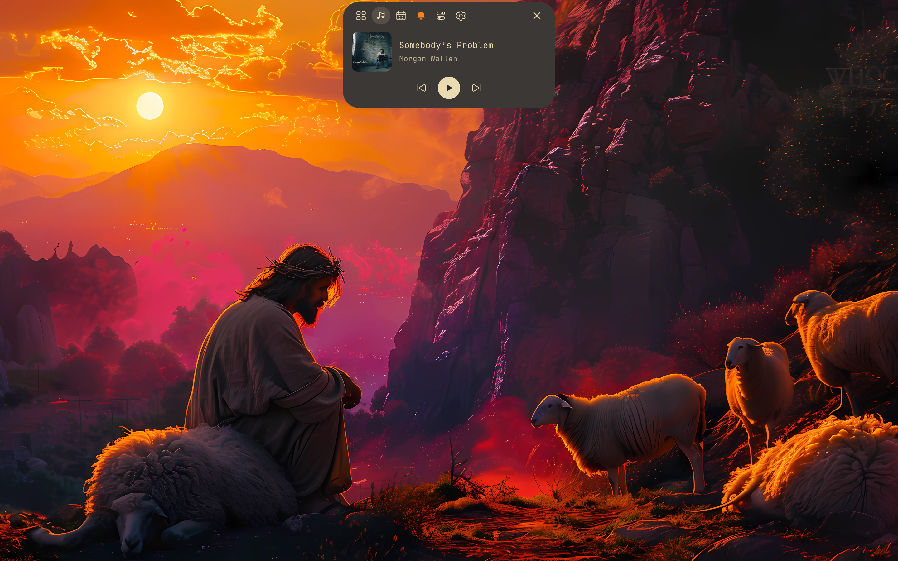

<p align="center">
  
</p>

<p align="center"><strong>A configurable Wayland desktop</strong></p>

<p align="center">
  <a href="https://github.com/ferese-wm/ferese/wiki/Installation">Install</a> ·
  <a href="https://github.com/ferese-wm/ferese/wiki/Configuration">Configure</a> ·
  <a href="https://github.com/ferese-wm/ferese/wiki/Screenshots">Screenshots</a> ·
  <a href="https://github.com/ferese-wm/ferese/wiki">Documentation</a>
</p>

Ferese combines a window manager and desktop shell with one configuration.



[View more screenshots](https://github.com/ferese-wm/ferese/wiki/Screenshots)

## Features

- Scrolling columns, window groups, tree tiling and floating windows with saved size and position
- Integrated shell with notifications, media controls, Settings and Control Center
- [Custom panels](https://github.com/ferese-wm/ferese/wiki/Panel-Configuration) with seven styles, editable groups and items, and top or bottom placement
- [Live Activities](https://github.com/ferese-wm/ferese/wiki/Live-Activities) for build status, running commands and progress from connected apps
- Workspace overview and recent-window switching
- [Continuum animations](https://github.com/ferese-wm/ferese/wiki/Configuration-Animations): interruptible springs, gesture momentum and shared motion controls
- Live wallpapers and blur, custom KDL themes, and Light/Dark/Auto modes
- Multiple monitors, fractional scaling and lower refresh rates on low battery
- Wi-Fi, Bluetooth and audio controls
- Custom keyboard shortcuts and touchpad gestures
- Screenshot annotation, screen sharing and recording
- Lock screen and authentication dialogs
- [Keep awake](https://github.com/ferese-wm/ferese/wiki/Configuration-Idle-Inhibition) during fullscreen media playback or for selected apps
- Continuous corners for windows and shell

## How Ferese compares

Ferese combines scrolling and tree layouts with its own desktop controls. The table
compares current upstream features and names separate tools where they are needed.

| Feature | Ferese | [Hyprland](https://github.com/hyprwm/Hyprland) | [niri](https://github.com/niri-wm/niri) |
| --- | --- | --- | --- |
| Tiling layouts | Scrolling columns and tree tiling; switch per workspace | [Scrolling, dwindle, master and monocle; per-workspace layouts](https://github.com/hyprwm/Hyprland#features) | Scrolling columns |
| Floating windows | Built in | Built in | Built in |
| Workspace overview | Built in | Plugins such as [HyprExpo](https://github.com/sandwichfarm/hyprexpo) | Built in |
| Animations | [Continuum](https://github.com/ferese-wm/ferese/wiki/Animation-Model): interruptible springs, gesture momentum; speed and reduced-motion settings shared by the compositor and shell | Bézier and spring curves | [Spring and easing animations; custom shaders](https://niri-wm.github.io/niri/Configuration:-Animations.html) |
| Corner shapes | Continuous corners across windows and shell | [Rounded corners and squircles](https://wiki.hypr.land/configuring/core/config-options/#decoration) | [Rounded corners with optional clipping](https://niri-wm.github.io/niri/Configuration:-Window-Rules.html#geometry-corner-radius) |
| Live configuration reload | Yes | Yes | Yes |
| Monitor mirroring | Built in | [Built in](https://wiki.hypr.land/configuring/core/monitors/) | Separate tool, such as [wl-mirror](https://niri-wm.github.io/niri/Screencasting.html#screen-mirroring) |
| Desktop controls | Included Settings and Control Center | [Separate utilities](https://wiki.hypr.land/hypr-ecosystem/) or a desktop shell | [Separate desktop shell or tools](https://niri-wm.github.io/niri/Integrating-niri.html#desktop-components) |
| Notifications | Included in ferese-shell | [Separate notification daemon](https://wiki.hypr.land/Useful-Utilities/Must-have/) | [Separate notification daemon or shell](https://niri-wm.github.io/niri/Integrating-niri.html) |
| Lock screen | Included ferese-lock | Separate [hyprlock](https://wiki.hypr.land/Hypr-Ecosystem/hyprlock/) | Separate locker, such as [swaylock or hyprlock](https://niri-wm.github.io/niri/Integrating-niri.html) |
| Screen-sharing backend | xdg-desktop-portal-ferese | [xdg-desktop-portal-hyprland](https://wiki.hypr.land/Hypr-Ecosystem/xdg-desktop-portal-hyprland/) | [xdg-desktop-portal-gnome](https://niri-wm.github.io/niri/Screencasting.html#overview) |

Ferese's shell, Settings, lock screen and dialogs use a shared theme. Other desktop
shells, including [DankMaterialShell and Noctalia](https://niri-wm.github.io/niri/Integrating-niri.html#desktop-components),
also include desktop controls; their features depend on the shell and tools you install.

## Install

Fedora and Arch package builds are covered in [Packages and releases](https://github.com/ferese-wm/ferese/wiki/Packages-and-Releases).

Start with the [dependencies](https://github.com/ferese-wm/ferese/wiki/Installation#requirements), then clone Ferese and
build it as your normal user:

```sh
git clone https://github.com/ferese-wm/ferese.git
cd ferese
./scripts/install.sh
```

Once it’s installed, log out and choose **Ferese** at your login screen, or run
`ferese-session` from a TTY or a greeter that accepts a command. The [installation
guide](https://github.com/ferese-wm/ferese/wiki/Installation) also walks you through previews, updates and recovery.

## Configure

Configure Ferese through **Control Center → Settings** or `~/.config/ferese/config.kdl`.
Changes apply live, and if an edit is invalid, the last working configuration stays
in place.

The [configuration reference](https://github.com/ferese-wm/ferese/wiki/Configuration) and [example
config](packaging/config.kdl) cover appearance, window layouts,
displays and startup apps.

## Default shortcuts

Use `Super`, usually the Windows key, to move around your desktop, and open **Settings →
Shortcuts** whenever you want to change a shortcut or gesture.

| Control | Action |
| --- | --- |
| Super + Enter | Open a terminal |
| Display Fn key (`XF86Display`) | Choose the display mode |
| Media Play / Pause, Next, Previous | Control the selected MPRIS player |
| Super + H / J / K / L | Focus left / down / up / right |
| Super + Backspace | Return to the last focused window |
| Super + Escape | Toggle between the last two visited workspaces on this monitor |
| Alt + Tab / Alt + Shift + Tab | Preview recent windows forward / backward; release Alt to select, Escape to cancel |
| Super + F | Maximize the window |
| Super + Shift + F | Toggle fullscreen |
| Super + R | Cycle column width |
| Super + Tab | Open overview |
| Super + M | Switch scrolling / tree layout |
| Print Screen | Capture the active monitor and open Satty |
| Super + Shift + S | Select a screenshot area |
| Super + Shift + E | Ask to log out |
| Super + left-button drag | Move a floating window |
| Super + right-button drag | Resize a floating window |
| Three-finger swipe up / down | Next / previous workspace |
| Three-finger swipe left / right | Focus the window to the right / left |

See [all shortcuts and mouse actions](https://github.com/ferese-wm/ferese/wiki/Shortcuts-and-Gestures) for window and workspace controls.

## Documentation

The [documentation index](https://github.com/ferese-wm/ferese/wiki) lists the desktop guides.
[Development instructions](https://github.com/ferese-wm/ferese/wiki/Development) cover building, testing and contributing.

Ferese is written in Rust using Smithay. Development happens [on
GitHub](https://github.com/ferese-wm/ferese). If something goes wrong, [open an
issue](https://github.com/ferese-wm/ferese/issues) with the steps to reproduce it and
any relevant logs.
