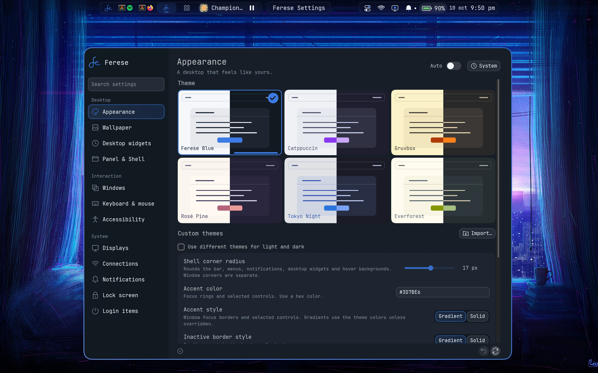
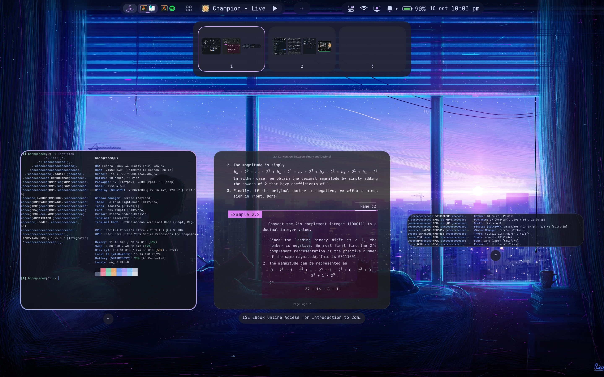

# Why Ferese

Alongside a window manager, you need Wi-Fi, audio and display controls, notifications and a lock screen. You can choose these components separately, but keeping their settings and behaviour consistent takes extra work.

Ferese includes a Wayland compositor, desktop shell, Settings, Control Center and a lock screen with shared configuration and theming. You can choose a window layout per workspace and change desktop settings through the GUI or a KDL file.

## Settings that apply beyond one component

An accent-colour change should reach the places where Ferese uses it, just as a motion-speed change should affect both window and shell transitions. The compositor and shell run in separate processes, but their shared theme and motion settings give them the same values to work from.

Settings and `~/.config/ferese/config.kdl` edit the same configuration, so you can change a display in Settings, then open the file to adjust a binding or window rule. Settings preserves comments and untouched configuration content when saving, and file changes reload automatically. If an edit is invalid, the last working configuration stays active.

Ferese can coordinate the surfaces it draws and the transitions it manages; it does not control every animation an application draws inside its own window.

## Different work needs different arrangements

A scrolling layout is useful when several windows need more space than can comfortably fit on one screen. Instead of shrinking everything to remain visible, the desktop can show part of a wider arrangement and move the viewport as focus changes. Tree tiling serves a different situation: the available screen is divided between windows so they can remain visible together.

Ferese supports both, with the layout selected per workspace. Floating windows are also available and remember their size and placement. A workspace can therefore use scrolling columns for a sequence of wide windows, while another uses tree tiling for a smaller set that needs to be viewed together.

Even within scrolling, moving focus does not always need to move the desktop. Ferese’s minimal focus strategy leaves a fully visible column where it is and scrolls only far enough to reveal a hidden edge. Other strategies centre the focused column or arrange columns into viewport-sized pages.

## Movement that responds to what you do next

An animation often starts before you have finished deciding what to do. You might focus another window while the viewport is moving, reverse a fullscreen transition, or reopen a panel before it has finished closing. The desktop needs to handle that next input using the state already on screen.

Continuum, Ferese’s shared motion system, keeps a moving value’s current position, velocity and destination. Changing the destination can preserve the existing movement instead of restarting from rest. A dragged window follows the pointer directly so it does not trail your hand; when you release a gesture, its velocity passes to a spring.

A window’s content, clipping and border need to follow the same presented bounds. When the application closes, its live surface may disappear before the visual exit finishes, so Ferese retains an image for that transition. Shell content and its compositor-drawn material also need to leave together, or the text can disappear while its background or blur remains.

## Testing on hardware

Resize coordination, output timing and interrupted transitions need testing and measurements on the hardware where the desktop runs. The [output management checks](output-management-testing.md) cover hotplug and display changes. Use the [nested resize checks](nested-resize-testing.md) for window resizing and the [client soak tests](native-soak-testing.md) for repeated window creation and cleanup.
